## 🔭 Recent Contributions

<!--START_SECTION:prs-->
| | Repository | ⭐ Stars | Merged PRs |
| :-: | :-- | --: | --: |
|  | [aletheia-works/vivarium](https://github.com/aletheia-works/vivarium) | 0 | [325](https://github.com/aletheia-works/vivarium/pulls?q=is%3Apr+author%3AJamBalaya56562+is%3Amerged) |
|  | [jdx/mise](https://github.com/jdx/mise) | 35.3k | [263](https://github.com/jdx/mise/pulls?q=is%3Apr+author%3AJamBalaya56562+is%3Amerged) |
|  | [duplicati/duplicati](https://github.com/duplicati/duplicati) | 15.2k | [254](https://github.com/duplicati/duplicati/pulls?q=is%3Apr+author%3AJamBalaya56562+is%3Amerged) |
|  | [duplicati/ngclient](https://github.com/duplicati/ngclient) | 16 | [92](https://github.com/duplicati/ngclient/pulls?q=is%3Apr+author%3AJamBalaya56562+is%3Amerged) |
|  | [duplicati/documentation](https://github.com/duplicati/documentation) | 5 | [37](https://github.com/duplicati/documentation/pulls?q=is%3Apr+author%3AJamBalaya56562+is%3Amerged) |
|  | [aubepkg/aube](https://github.com/aubepkg/aube) | 2.0k | [21](https://github.com/aubepkg/aube/pulls?q=is%3Apr+author%3AJamBalaya56562+is%3Amerged) |

**🆕 Latest merged pull requests**

- `2026-10-23` **duplicati/ngclient** — [Preserve a single wildcard in expression filters](https://github.com/duplicati/ngclient/pull/591)
- `2026-10-23` **duplicati/duplicati** — [Stop waiting for a stuck source listing when the backup is aborted](https://github.com/duplicati/duplicati/pull/7520)
- `2026-10-22` **google/go-github** — [fix: Handle string-valued error responses](https://github.com/google/go-github/pull/4660)
- `2026-10-21` **fabric8io/docker-maven-plugin** — [Retry the macOS integration tests only when the VM's resolver times out](https://github.com/fabric8io/docker-maven-plugin/pull/1970)
- `2026-10-21` **aletheia-works/vivarium** — [build(docs): pin the release-please test engine to the action's bundled version](https://github.com/aletheia-works/vivarium/pull/550)
- `2026-10-19` **duplicati/documentation** — [Mention the default database encryption on the server authentication page](https://github.com/duplicati/documentation/pull/49)
- `2026-10-18` **jdx/mr-boxington** — [fix(mise): replace the bootstrap binary while a previous one still runs](https://github.com/jdx/mr-boxington/pull/740)
- `2026-10-18` **jdx/mise** — [fix(shim): render command wrappers with their config file's config_root](https://github.com/jdx/mise/pull/14628)

1,598 merged PRs to other projects · updated 2026-10-24 by GitHub Actions
<!--END_SECTION:prs-->

## ⚡ Tech Stack

 

 

## 📊 GitHub Stats

 

## 🐍 Contribution Snake

<picture>
  <source media="(prefers-color-scheme: dark)" srcset="./profile/snake-dark.svg">
  <source media="(prefers-color-scheme: light)" srcset="./profile/snake.svg">
  
</picture>

