## 🔭 Recent Contributions

<!--START_SECTION:prs-->
| | Repository | ⭐ Stars | Merged PRs |
| :-: | :-- | --: | --: |
|  | [duplicati/duplicati](https://github.com/duplicati/duplicati) | 15.2k | [541](https://github.com/duplicati/duplicati/pulls?q=is%3Apr+author%3AJamBalaya56562+is%3Amerged) |
|  | [duplicati/ngclient](https://github.com/duplicati/ngclient) | 16 | [322](https://github.com/duplicati/ngclient/pulls?q=is%3Apr+author%3AJamBalaya56562+is%3Amerged) |
|  | [motioneye-project/motioneye](https://github.com/motioneye-project/motioneye) | 4.7k | [72](https://github.com/motioneye-project/motioneye/pulls?q=is%3Apr+author%3AJamBalaya56562+is%3Amerged) |
|  | [aletheia-works/.github](https://github.com/aletheia-works/.github) | 0 | [53](https://github.com/aletheia-works/.github/pulls?q=is%3Apr+author%3AJamBalaya56562+is%3Amerged) |
|  | [aletheia-works/formicarium](https://github.com/aletheia-works/formicarium) | 1 | [25](https://github.com/aletheia-works/formicarium/pulls?q=is%3Apr+author%3AJamBalaya56562+is%3Amerged) |
|  | [aletheia-works/paludarium](https://github.com/aletheia-works/paludarium) | 2 | [7](https://github.com/aletheia-works/paludarium/pulls?q=is%3Apr+author%3AJamBalaya56562+is%3Amerged) |

**🆕 Latest merged pull requests**

- `2026-11-24` **duplicati/duplicati** — [Fix the ShellCheck warnings in the shell scripts](https://github.com/duplicati/duplicati/pull/7976)
- `2026-11-24` **aletheia-works/.github** — [fix(workflows): stop OpenTofu runs on a lost state and keep plans from cancelling applies](https://github.com/aletheia-works/.github/pull/96)
- `2026-11-24` **aletheia-works/formicarium** — [fix(showcase): build libtasn1 for GnuTLS and drop the 3.8.13 pin](https://github.com/aletheia-works/formicarium/pull/317)
- `2026-11-23` **duplicati/ngclient** — [Use Signal Forms for the run-after failure toggle](https://github.com/duplicati/ngclient/pull/830)
- `2026-11-19` **motioneye-project/motioneye** — [fix(uploadservices): tell Dropbox's own error, not a failed refresh](https://github.com/motioneye-project/motioneye/pull/3570)
- `2026-11-13` **aletheia-works/paludarium** — [refactor(release): remove the JSR skip of 0.15.0, which is released](https://github.com/aletheia-works/paludarium/pull/561)

2,282 merged PRs to other projects · updated 2026-11-24 by GitHub Actions
<!--END_SECTION:prs-->

## ⚡ Tech Stack

 

 

## 📊 GitHub Stats

 

## 🐍 Contribution Snake

<picture>
  <source media="(prefers-color-scheme: dark)" srcset="./profile/snake-dark.svg">
  <source media="(prefers-color-scheme: light)" srcset="./profile/snake.svg">
  
</picture>

