## 🔭 Recent Contributions

<!--START_SECTION:prs-->
| | Repository | ⭐ Stars | Merged PRs |
| :-: | :-- | --: | --: |
|  | [aletheia-works/vivarium](https://github.com/aletheia-works/vivarium) | 0 | [360](https://github.com/aletheia-works/vivarium/pulls?q=is%3Apr+author%3AJamBalaya56562+is%3Amerged) |
|  | [duplicati/duplicati](https://github.com/duplicati/duplicati) | 15.2k | [321](https://github.com/duplicati/duplicati/pulls?q=is%3Apr+author%3AJamBalaya56562+is%3Amerged) |
|  | [jdx/mise](https://github.com/jdx/mise) | 35.7k | [263](https://github.com/jdx/mise/pulls?q=is%3Apr+author%3AJamBalaya56562+is%3Amerged) |
|  | [duplicati/ngclient](https://github.com/duplicati/ngclient) | 16 | [130](https://github.com/duplicati/ngclient/pulls?q=is%3Apr+author%3AJamBalaya56562+is%3Amerged) |
|  | [google/go-github](https://github.com/google/go-github) | 11.3k | [49](https://github.com/google/go-github/pulls?q=is%3Apr+author%3AJamBalaya56562+is%3Amerged) |
|  | [motioneye-project/motioneye](https://github.com/motioneye-project/motioneye) | 4.7k | [35](https://github.com/motioneye-project/motioneye/pulls?q=is%3Apr+author%3AJamBalaya56562+is%3Amerged) |

**🆕 Latest merged pull requests**

- `2026-11-03` **motioneye-project/motioneye** — [enh(sendtelegram): send with http.client instead of pycurl](https://github.com/motioneye-project/motioneye/pull/3514)
- `2026-11-03` **aletheia-works/vivarium** — [feat(layer3): open each preview from its gallery card and drop its page](https://github.com/aletheia-works/vivarium/pull/670)
- `2026-11-02` **duplicati/ngclient** — [Honor the selected file export encryption options](https://github.com/duplicati/ngclient/pull/640)
- `2026-11-02` **duplicati/duplicati** — [Allow the Storj idle timeout test one step of the tick count](https://github.com/duplicati/duplicati/pull/7660)
- `2026-10-31` **google/go-github** — [refactor!: Add `ProvisionAndInviteSCIMUserRequest` and pass it by value to `ProvisionAndInviteSCIMUser`](https://github.com/google/go-github/pull/4697)
- `2026-10-30` **duplicati/documentation** — [Document the fixes in Duplicati 2.4.1.0](https://github.com/duplicati/documentation/pull/54)
- `2026-10-26` **aubepkg/aube** — [fix(install): link the bins of a dependency's link: deps into its .bin](https://github.com/aubepkg/aube/pull/1873)
- `2026-10-25` **biomejs/biome** — [fix(migrate): carry Prettier's bracketSpacing into the top-level](https://github.com/biomejs/biome/pull/12670)

1,774 merged PRs to other projects · updated 2026-11-03 by GitHub Actions
<!--END_SECTION:prs-->

## ⚡ Tech Stack

 

 

## 📊 GitHub Stats

 

## 🐍 Contribution Snake

<picture>
  <source media="(prefers-color-scheme: dark)" srcset="./profile/snake-dark.svg">
  <source media="(prefers-color-scheme: light)" srcset="./profile/snake.svg">
  
</picture>

